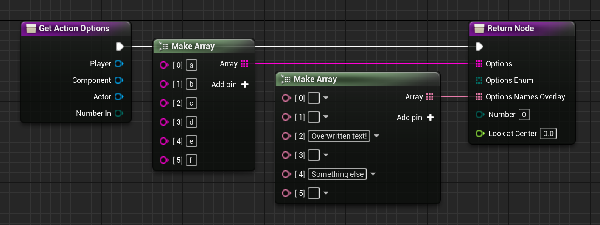
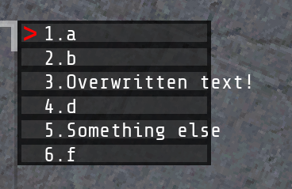

# Customizing the interaction menu
This guide requires you to have complex prop. Check out those instructions first if you haven't already.

## Interfaces primer
Now, if you look in your custom prop's class settings, you can see it inherits a couple of interfaces from the parent `prop` class, including `int_player`, `int_objects`, and `int_save`. If you look at the variables pane and expand the "Interfaces" tab, you can take a look at all the different functions that are provided by these interfaces.

These interfaces allow you to change and modify the behavior of your prop and are very powerful. But there's an important warning to heed: **some of these interface functions may not behave like you expect or even work at all**. So expect to test a lot.

To use an interface method, right-click the entry in the list and click on "Implement event", or go to function overrides and select it from there.

## 'lookAt' method
This interface method influences what happens when the player looks directly at the object.

It provides these fields to return:
- Return - Whether the prop can be interacted with and whether interaction menu should appear.
- Text - The text that appears at the bottom of the interaction menu. You can put whatever text you want here. For example, batteries and gas cans use this text to show how much they have left in them.
- Bound Object Replace - This pin is optional. If you've customized the prop with some custom meshes or additional components, then the interaction menu's box may end up not correctly sizing itself around the prop. This pin allows you to provide a replacement object to calculate the bounds of the object. For an example for how to use this, create a custom StaticMesh component, set its mesh to a box and size it around your object, set it's `HiddenToGame` to true, and feed that component into this pin.
- Number - Unknown

## 'getActionOptions' method
This method lets you define the action menu that pops up when you hold use on a prop.

You will need to make a decision here: The method provides two different ways to create the list of actions. You can provide an array of strings, or an array of interactionEnum. Note that *there is absolutely no functional difference* here, but you can only use one. The interactionEnum provides 14 different actions like "Grab", "Toggle", "Activate", etc., while you can set the string array to absolutely anything. If you intend to add an action that has a very custom name, then you'll want to go with the string array.

For the option you choose, make an array and feed it into the `Options` or `Options Enum` pin. Each element in the array represents a separate action in the action list.

Additionally, you can optionally provide a "Overlay" array. This array allows you to overwrite the text of the action in the interaction menu without changing the action's internal name. If the overlay's text is empty, then it does not overwrite the action text.

\

Now that your prop has actions, it is able to trigger a function whenever an action is chosen. That's where the below two interface events come in. Which one you use depends on whether you are using a string array or enum array for the options above.\
If you are using a string array, then interactions will come through the [actionName event](#actionname-event).\
If you instead used an enum array, then interactions will come through the [actionOptionIndex event](#actionoptionindex-event).

### 'actionName' event
This event returns a `Name` variable which contains the action which was selected in the action menu.

### 'actionOptionIndex' event
This event returns an `Action` variable which contains the action which was selected in the action menu.
